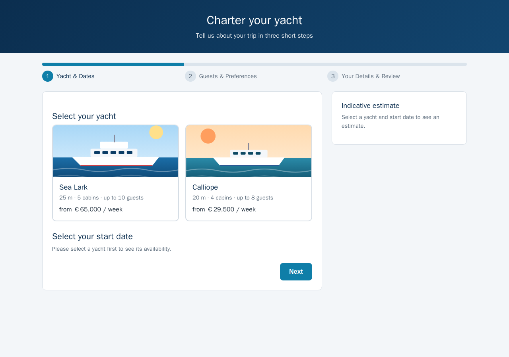
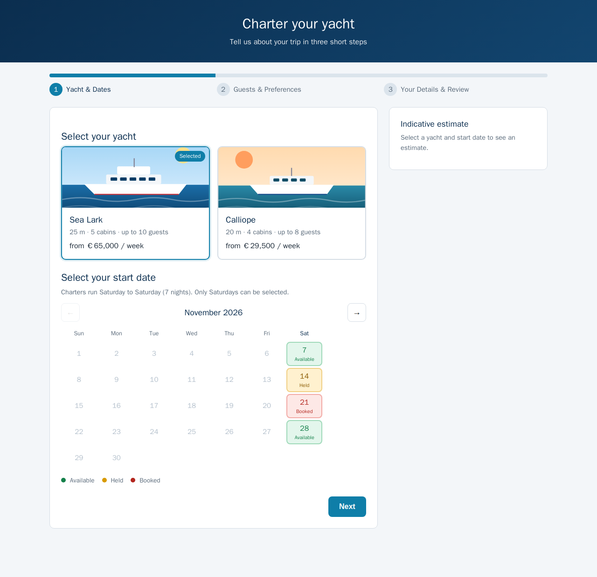
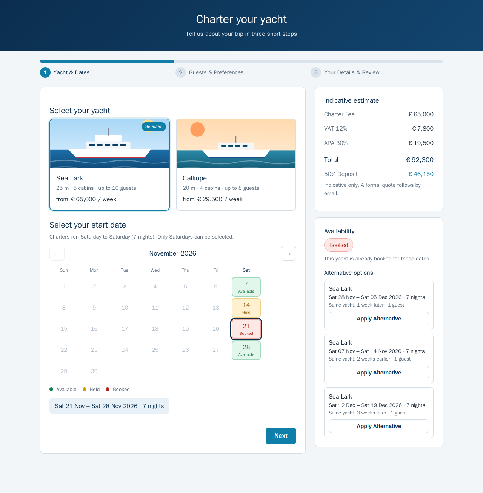
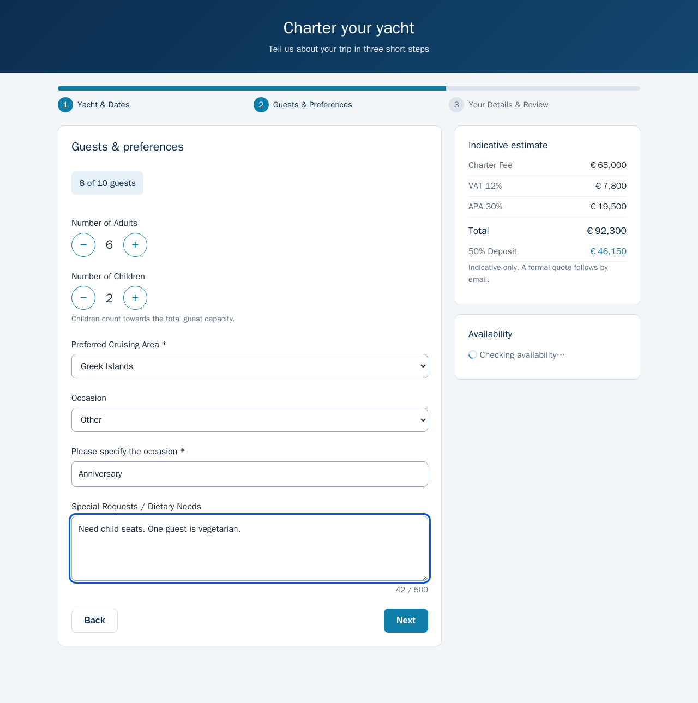
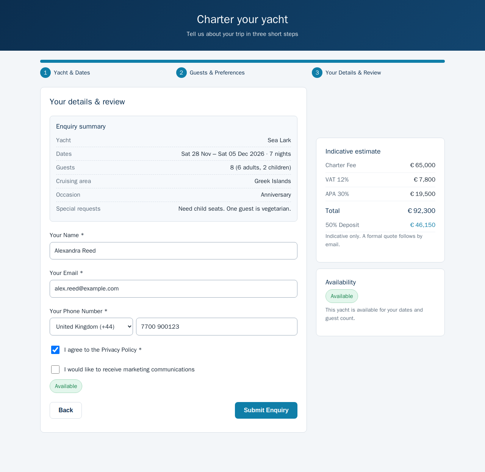
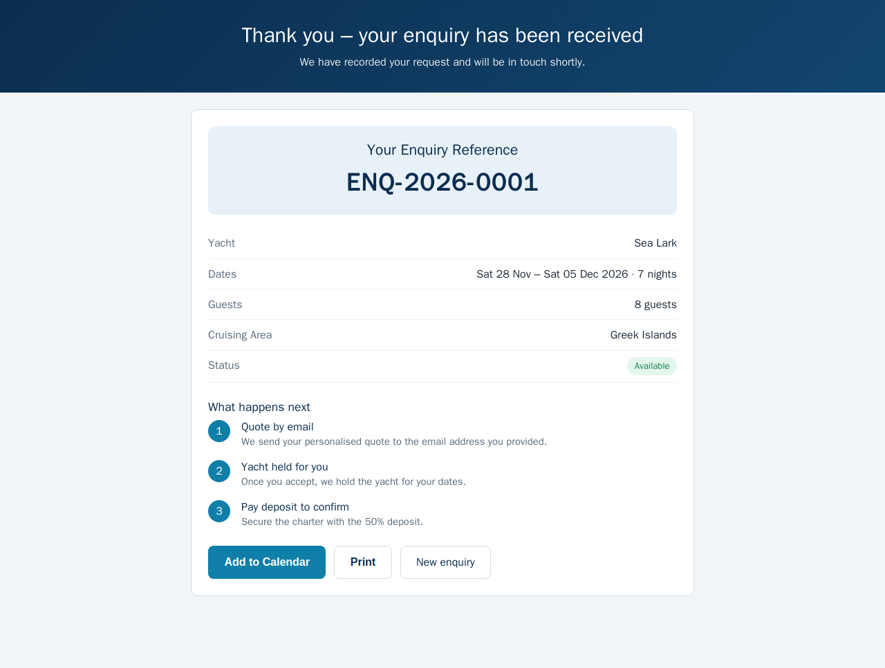
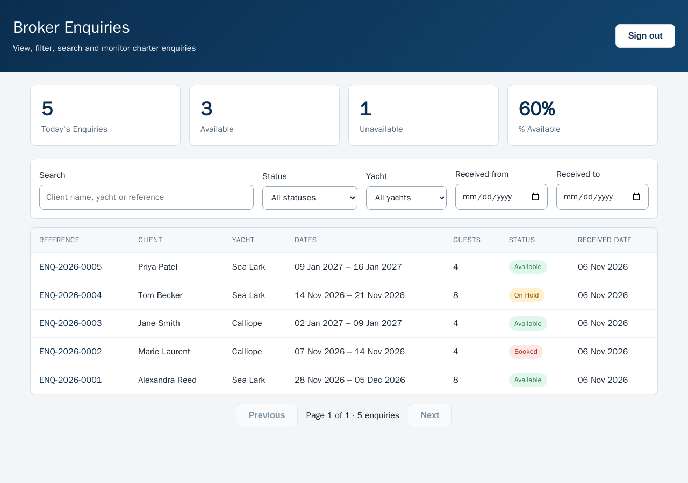
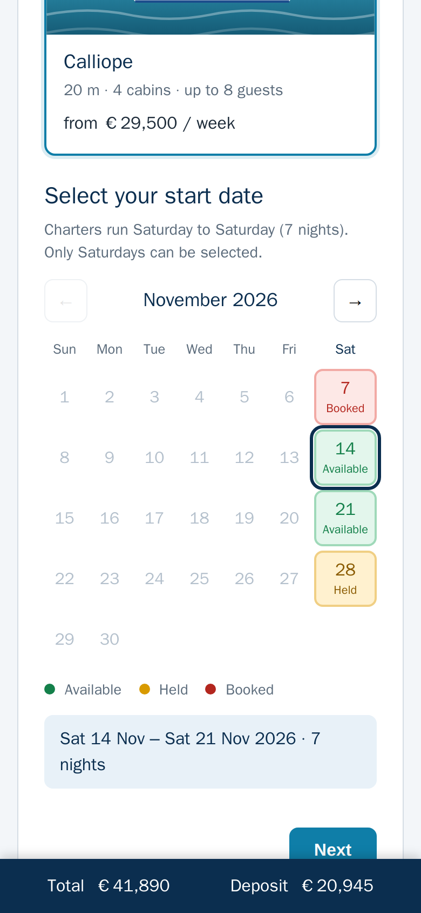

# Charter Enquiry System (C1)

Charter enquiry form for clients (SCR-01, SCR-02) and an enquiries dashboard for Charter Brokers (SCR-03),
built from *C1 · Charter enquiry form · Build specification v0.4*.

- **Front end:** React 18 + Vite + TypeScript (`src/frontend`)
- **Back end:** Express + SQLite (`src/backend`)
- **Shared:** types, validators, date and pricing rules used by both sides (`src/shared`)

## Run it

```bash
npm install --include=dev      # dev dependencies are needed for tests/build
npm run build                  # builds the UI into dist/frontend
npm start                      # API + built UI on http://localhost:3000
```

`npm start` serves the built UI and the API from one port. If port 3000 is busy it takes the next free one
(set `PORT` to choose the starting port). Open `/charter/enquiry` (client) or `/broker/enquiries` (broker).

For development with hot reload: `npm run dev` (API on 3000, UI on 5173 with an `/api` proxy; if the API had to
fall back to another port, start the UI with `API_PORT=<port> npm run dev:frontend`).

**Broker sign-in.** SCR-03 and API-05 require a Broker session. Set `BROKER_ACCESS_CODE` to choose the access
code; if it is not set the server generates one and prints it at start-up. Identity management is out of scope
for C1, so this stands in for the real login: the code is exchanged for a random session token that carries the
`Broker` role (`401` without a session, `403` for a session without the role).

Other settings: `DB_PATH` (SQLite file, default `./data.sqlite3`; `:memory:` works).

```bash
npm test            # backend + shared + frontend (jest)
npm run type-check
```

## Screenshots

Captured from the running app (`docs/screenshots`):

| | |
|---|---|
|  |  |
|  |  |
|  |  |
|  |  |

## Requirement coverage

| Spec item | Where | Verified by |
|---|---|---|
| US-01 guided submit, inline errors, redirect with reference | `EnquiryForm`, `Step*` | `enquiryForm.test.tsx` |
| US-02 / R-02 server validation → 400 | `shared/validators.ts`, API-01 | `api.test.ts` (25 rejection cases) |
| US-03 / R-04 `ENQ-YYYY-NNNN`, sequential, unique | `bookingReferenceService` (atomic upsert) | `api.test.ts` (concurrent submissions) |
| US-04 yacht cards | `YachtSelector` | `enquiryForm.test.tsx` |
| US-05 Saturday-only calendar, Available/Held/Booked, auto end date, `Sat DD Mon – Sat DD Mon YYYY · 7 nights` | `DatePicker`, `shared/dates.ts` | `enquiryForm.test.tsx`, `shared.test.ts` |
| US-06 / R-06 guest stepper, `X of Y guests`, re-fit on yacht change | `Stepper`, `StepGuests` | `enquiryForm.test.tsx`, `api.test.ts` |
| US-07 / R-07–R-09 estimate (VAT 12%, APA 30%, deposit 50% of total) | `shared/pricing.ts`, `PricingSummary` | `shared.test.ts`, `enquiryForm.test.tsx` |
| US-08 / R-10 live check after 400 ms, badges, Submit gating | `useLiveAvailability`, `LiveStatus` | `enquiryForm.test.tsx` |
| US-09 up to 3 alternatives, Apply Alternative | `availabilityService.findAlternatives`, `LiveStatus` | `api.test.ts`, `enquiryForm.test.tsx` |
| US-10 progress bar, Back/Next keep data, refresh restores | `ProgressBar`, `useEnquiryForm` (localStorage) | `enquiryForm.test.tsx` |
| US-11 children, occasion (+Other), special requests ≤ 500 | `StepGuests` | `enquiryForm.test.tsx`, `shared.test.ts` |
| US-12 summary card, required privacy consent, optional marketing opt-in | `StepDetails` | `enquiryForm.test.tsx` |
| US-13 confirmation: reference, summary, status, timeline, Add to Calendar (.ics), Print | `ConfirmationPage`, `utils/ics.ts` | `pages.test.tsx` |
| US-14 / API-05 table of enquiries | `BrokerDashboardPage` | `pages.test.tsx`, `api.test.ts` |
| US-15 filters (status, yacht, received date range), search, 4 KPI tiles | `BrokerDashboardPage`, API-05 | `pages.test.tsx`, `api.test.ts` |
| API-01 … API-05 incl. error codes | `backend/app.ts` | `api.test.ts` |
| §9 confirmation email | `notificationService` (logs the message; no mail provider is wired up) | `api.test.ts` |
| §10 C2 trigger; on failure log, `IntegrationError`, alert broker | `c2Service` | `api.test.ts` |
| §12 edge cases: API-04 failure, yachts/availability load failure, 500s, malicious input, draft restore | various | `enquiryForm.test.tsx`, `api.test.ts` |
| NFR-03 broker auth (401/403) | `auth.ts` | `api.test.ts` |
| NFR accessibility (labels, `aria-*`, keyboard, focus, live regions, skip link, print styles) | components | manual + screenshots |

### Out of scope (per spec §1)

Holding yacht dates, quote/contract generation, payments and e-signatures are not implemented here.
C2 is represented by a stand-in (`c2_calendar` table + `availabilityService`): any Saturday without a row is
Available; rows mark it Held or Booked. Demo rows are seeded relative to today. Submitting an enquiry does **not**
block a date; after submission the stand-in C2 check sets the enquiry status
(`Available` / `OnHold` / `Booked` / `CapacityExceeded`), starting from `Submitted`.

## Assumptions on the spec's open questions

1. **Phone format** – E.164 after removing spaces, dashes, dots and brackets: `+`, no leading `0`, 7–15 digits.
   The client builds it from the picker and the national number (a leading trunk `0` is dropped).
2. **Country codes** – a short list in `shared/constants.ts` (`COUNTRY_CODES`); extend as needed.
3. **Alternatives** – at most 3.
4. **"Nearest free Saturdays within ±3 weeks"** – same yacht, nearest first (earlier before later on ties), then
   other yachts that fit the party on the same date (or their nearest free Saturday in range).

Other decisions: a start date must be strictly after today (UTC); broker KPIs are computed over the currently
filtered result set (so `percentAvailable = available / total` matches the table); the received-date filter is
inclusive of both days.
